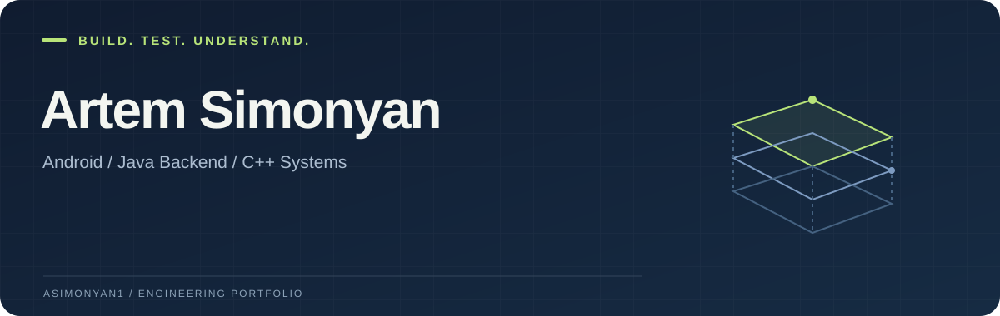
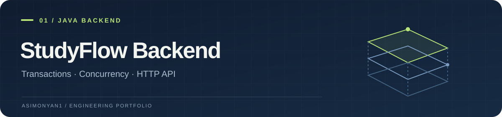
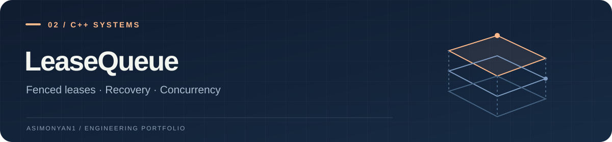
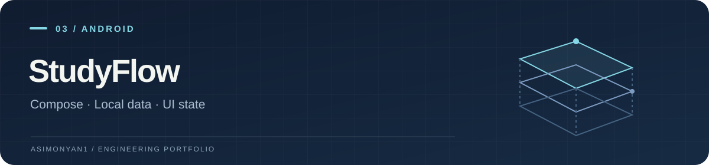
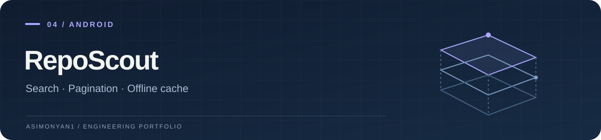

  <a href="#проекты">Проекты</a> &nbsp; · &nbsp;
  <a href="https://github.com/ASimonyan1/studyflow-backend/blob/main/docs/DECISIONS.md">Архитектурные решения</a> &nbsp; · &nbsp;
  <a href="mailto:artemsimonan81@gmail.com">Связаться</a>

## Привет, я Артём

Студент **2 курса РТУ МИРЭА**, направление «Системная и программная инженерия», выпуск в **2029**. Москва.

Развиваюсь в мобильной и серверной разработке. В проектах разбираю полный путь данных: от состояния Android-интерфейса и сетевых запросов до транзакций БД и конкурентной обработки заданий. Мне интересны корректность при сбоях, понятные контракты и тесты, которые проверяют поведение.

**Открыт к стажировкам:** Android / Kotlin · Java backend · C++ backend.

## Проекты

<table>
<tr>
<td width="50%" valign="top">

<b>StudyFlow Backend</b> 
Java 21 · Spring Boot · PostgreSQL · Hibernate  
REST API: идемпотентное создание, optimistic locking, атомарные пакеты и аудит. Интеграционные тесты на настоящем PostgreSQL.  
<a href="https://github.com/ASimonyan1/studyflow-backend">Код</a> · <a href="https://github.com/ASimonyan1/studyflow-backend/blob/main/docs/DECISIONS.md">Архитектура</a> · <a href="https://github.com/ASimonyan1/studyflow-backend/actions">CI</a>
</td>
<td width="50%" valign="top">

<b>LeaseQueue</b> 
C++20 · STL · Threads · CMake  
Очередь заданий: аренда с token, retry, восстановление из журнала. Конкурентные тесты и явные гарантии при ошибках записи.  
<a href="https://github.com/ASimonyan1/leasequeue-cpp">Код</a> · <a href="https://github.com/ASimonyan1/leasequeue-cpp/blob/main/docs/DESIGN.md">Дизайн</a> · <a href="https://github.com/ASimonyan1/leasequeue-cpp/actions">CI</a>
</td>
</tr>
<tr>
<td valign="top">

<b>StudyFlow Android</b> 
Kotlin · Jetpack Compose · Room · Flow  
Учебный планировщик: предметы, дедлайны, фильтры и локальное хранение. Проверки базы и UI на эмуляторе.  
<a href="https://github.com/ASimonyan1/studyflow-android">Код и скриншоты</a> · <a href="https://github.com/ASimonyan1/studyflow-android/blob/main/docs/WALKTHROUGH.md">Разбор</a> · <a href="https://github.com/ASimonyan1/studyflow-android/actions">APK / CI</a>
</td>
<td valign="top">

<b>RepoScout</b> 
Kotlin · Retrofit · OkHttp · Room  
Поиск GitHub-проектов: пагинация, отмена устаревших запросов, кеш и избранное. HTTP-тесты через MockWebServer.  
<a href="https://github.com/ASimonyan1/reposcout-android">Код</a> · <a href="https://github.com/ASimonyan1/reposcout-android/blob/main/docs/TESTING.md">Проверки</a> · <a href="https://github.com/ASimonyan1/reposcout-android/actions">APK / CI</a>
</td>
</tr>
</table>

**[Algorithms Lab →](https://github.com/ASimonyan1/algorithms-lab)** — C++17, 15 алгоритмов и структур данных. Разбор сложности, граничные случаи, сравнение со STL и полным перебором; Linux/Windows, AddressSanitizer и UBSan.

Все проекты — учебная инженерная практика. README содержат команды запуска, тесты и границы реализации. StudyFlow Android пока работает локально; подключение к backend — отдельный следующий этап.

## Технологии в коде

| Направление | С чем работаю в проектах |
|---|---|
| **Android** | Kotlin, Compose, Material 3, ViewModel, Coroutines/Flow, Room, Retrofit |
| **Java backend** | Java 21, Spring Boot, JPA/Hibernate, PostgreSQL, Flyway, HTTP/JSON |
| **C++** | C++17/20, STL, RAII, потоки и mutex, CMake, алгоритмы и структуры данных |
| **Проверки** | JUnit, Mockito, MockMvc, MockWebServer, Compose UI tests, sanitizers |
| **Инструменты** | Git, Gradle, GitHub Actions, Docker Compose |

Университетская база: ООП, алгоритмы и структуры данных, C++, Java и Python. В каждом направлении стремлюсь понимать не только успешный сценарий, но и поведение при ошибках и конкуренции.

---

  <b>Обсудим проект или стажировку?</b> 
  <a href="mailto:artemsimonan81@gmail.com">artemsimonan81@gmail.com</a> &nbsp; · &nbsp;
  <a href="https://t.me/arti_kx">Telegram @arti_kx</a> 
  Москва · РТУ МИРЭА · 2029

